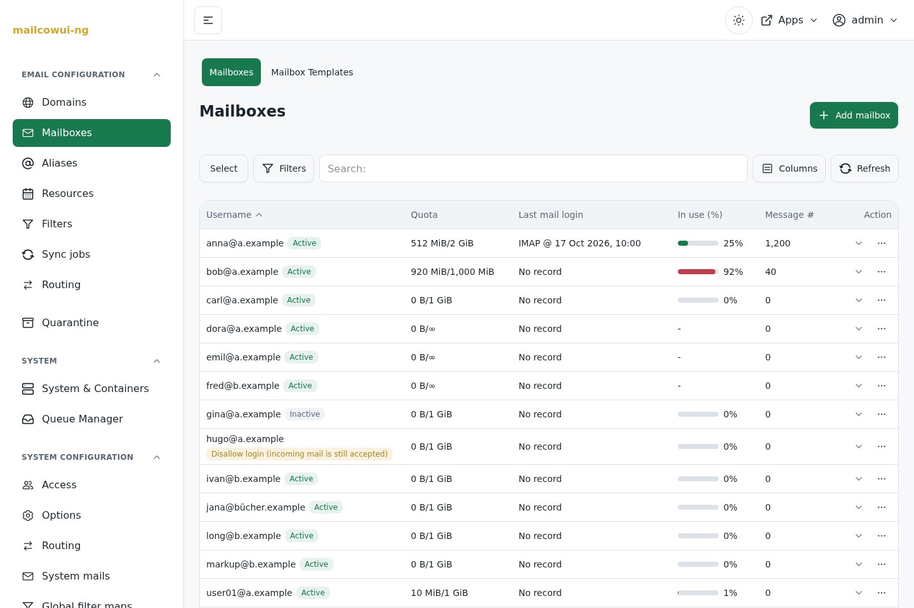
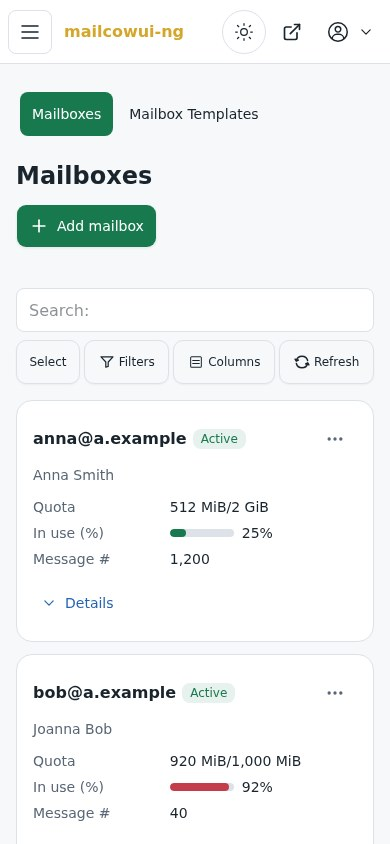
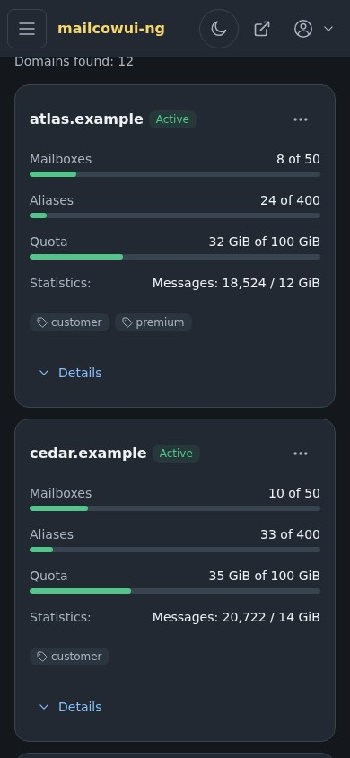

# mailcow Modern UI

A modern web interface for mailcow, with compact desktop tables, mobile layouts,
light and dark themes, and a shared design across administration and account settings.

**[Install manually](docs/installation.md) · [Install with Ansible](docs/ansible.md) ·
[Update or uninstall](docs/maintenance.md) · [Download the screenshot tour](https://github.com/FELDSAM-INC/mailcow-modern-ui/raw/refs/heads/main/docs/mailcow-modern-ui-showcase.html)**

<picture>
  <source media="(prefers-color-scheme: dark)" srcset="docs/screenshots/mailboxes-dark.jpg">
  
</picture>

## What you get

- **Email administration:** domains, mailboxes, aliases, resources, filters, sync jobs, and routing.
- **Operations:** quarantine, queue management, containers, logs, and audit history.
- **Account access:** administrator, domain administrator, and mailbox user views; password reset, two-factor authentication, and passkeys.
- **Consistent controls:** search, filters, column selection, row actions, and expandable details.
- **Your branding:** configurable logos and colours, with light and dark themes.

<p>
  
  
</p>

Screenshots use sample data, captured on **25 October 2026** from UI revision
`3c0ea10d`. They illustrate that preview; newer builds may look different.
The [full gallery](docs/index.html) includes both themes and an offline HTML download.

## Installation

Install on an **existing, running mailcow server** with HTTPS.
The currently supported release is **mailcow `2026-09a`**, database schema
`18082026_1200`. Other schemas fail the API readiness check.
This is a community development preview, maintained independently of the mailcow project.

Both installation paths pull public images for **Linux AMD64 and ARM64**.
No application build or registry login is needed.

| Method | Start here |
| --- | --- |
| Manual | [Copy the commands one at a time](docs/installation.md) |
| Ansible | [Edit an inventory and run one playbook](docs/ansible.md) |

The new UI is served at **`https://mail.example.org/ng/`** and the API at **`/api/v2/`**.
Sign in with existing mailcow accounts. The classic interface remains at `/`.
Installation adds two containers to the existing mailcow Compose project, keeps its
custom overrides, and stores the application key privately. The API creates its own
`restv2_` tables; it does not migrate mailcow's tables.

The default `latest` images follow successfully published `main` builds. They are a
moving development channel. Use image digests when you need a fixed deployment.

## Projects and images

| Component | Source | Public image |
| --- | --- | --- |
| Web interface | [mailcowui-ng](https://github.com/FELDSAM-INC/mailcowui-ng) | `ghcr.io/feldsam-inc/mailcowui-ng` |
| REST API | [mailcow-rest-v2](https://github.com/FELDSAM-INC/mailcow-rest-v2) | `ghcr.io/feldsam-inc/mailcow-rest-v2` |
| Showcase and deployment | This repository | Uses the two images above |

Application development stays in the component repositories. This repository owns
the installation guide, Ansible playbook, shared deployment configuration, and screenshots.
Configuration source revisions are recorded in [deploy/sources.json](deploy/sources.json).

## Contributing

Report installation/documentation issues here. Report UI and API issues in their source
repositories. Include versions and steps to reproduce; remove passwords and tokens from logs.
For a private security report, see [SECURITY.md](SECURITY.md).

Run the installation checks locally with Docker Compose available; they use temporary
fixtures and do not start containers or contact a mail server:

```bash
python3 -m unittest discover -s tests -v
```

```bash
ansible-playbook -i ansible/inventory.example.yml ansible/install.yml --syntax-check
```

The [gallery maintenance guide](docs/showcase.md) explains screenshot provenance,
offline packaging, and optional GitHub Pages hosting.

## License

[GPL-3.0](LICENSE), consistent with the two application repositories.
The interface uses TailAdmin Free; see [third-party notices](NOTICE.md).
